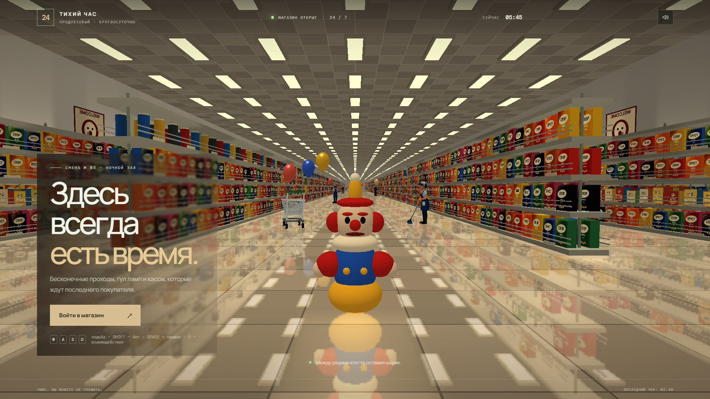
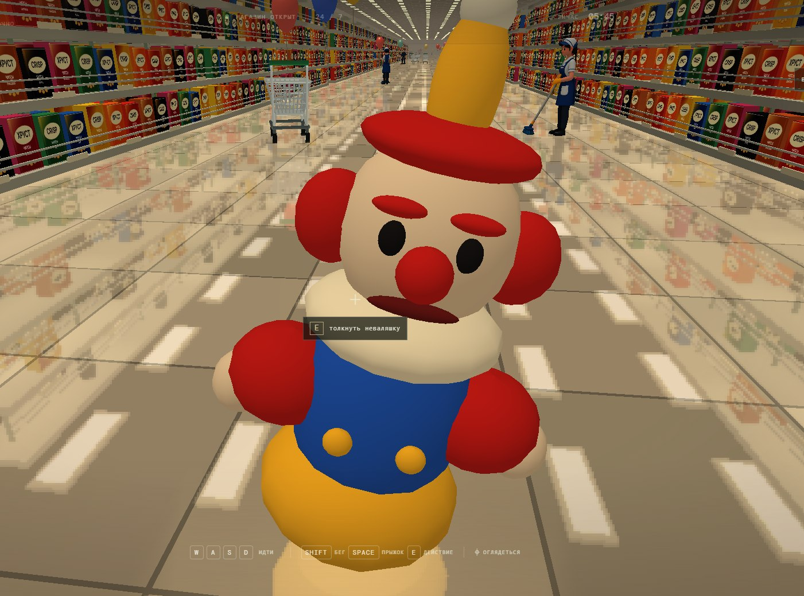
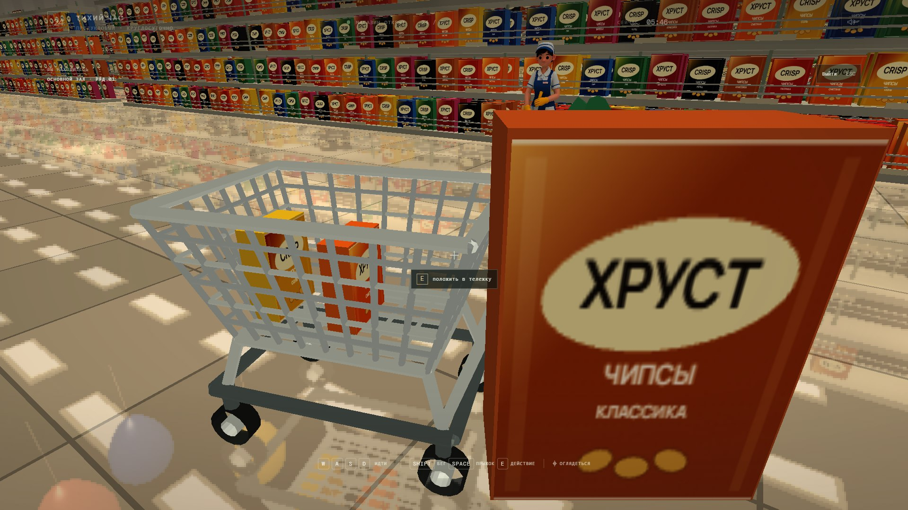
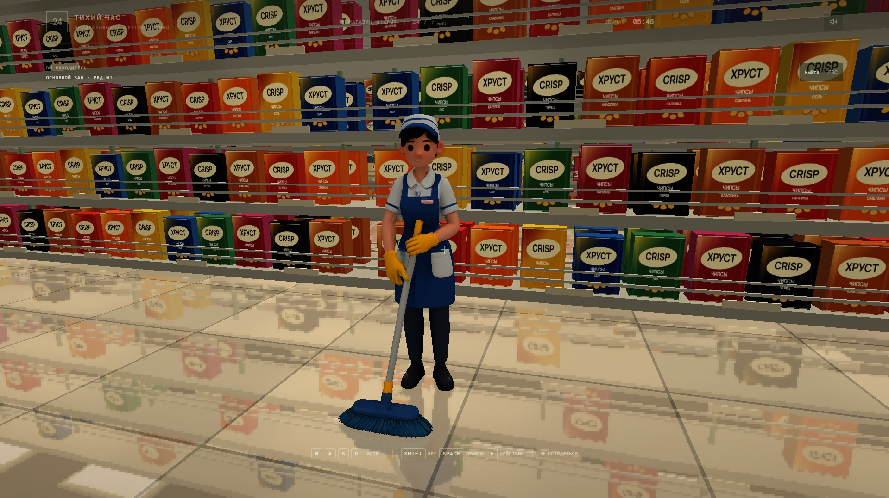

# «Тихий час» — лиминальный магазин

Небольшая атмосферная 3D-игра-прогулка на WebGPU. Исследуйте огромный ночной супермаркет с длинными рядами товаров, плиточным полом, кассами, тележками, уборщиками и воздушными шариками.






## Запуск

Для проекта не требуется сборка или установка зависимостей. Нужен браузер с поддержкой WebGPU и локальный HTTP-сервер: ES-модули и загрузка модели не работают при простом открытии `index.html` через `file://`.

1. Откройте терминал в папке проекта.
2. Запустите сервер, например:

   ```powershell
   python -m http.server 8000
   ```

3. Перейдите в браузере по адресу <http://localhost:8000>.
4. Нажмите **«Войти в магазин»** и разрешите управление мышью.

Если команда `python` не найдена, установите Python или запустите любой другой статический HTTP-сервер из папки проекта. WebGPU доступен не во всех браузерах и конфигурациях; при отсутствии поддержки игра покажет сообщение об ошибке.

## Управление

| Клавиша | Действие |
| --- | --- |
| `W` `A` `S` `D` | Ходьба |
| `Shift` | Бег |
| `Space` | Прыжок |
| Мышь | Осмотреться |
| `E` | Взаимодействовать с объектом перед игроком |
| `Esc` | Отпустить захват мыши и выйти из прогулки |

Клавишей `E` можно взять товар с полки, положить его в тележку или бросить, толкнуть тележку, задеть неваляшку или отправить шарик в полёт. Фоновую музыку можно включить или выключить кнопкой с иконкой динамика в верхней части экрана.

## Содержимое проекта

- `index.html` — экран входа, HUD и подключение ресурсов.
- `main.js` — генерация сцены, WebGPU-рендеринг, управление, взаимодействия и звуки.
- `style.css` — оформление интерфейса.
- `models/woman_clean.glb` — модель уборщицы.
- `music/` — фоновая музыка.
- `sounds/` — звуки тележки, шарика, неваляшки и шагов.
- `screens/` — скриншоты и визуальные референсы.
